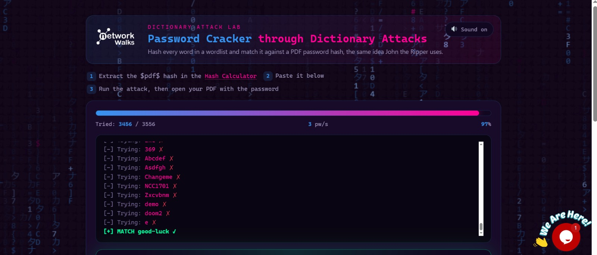
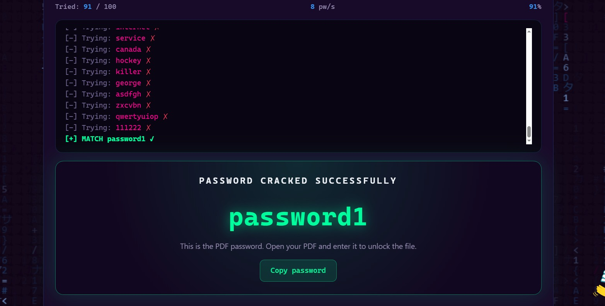
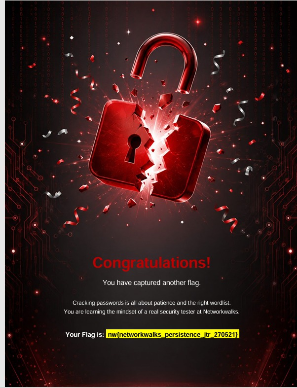
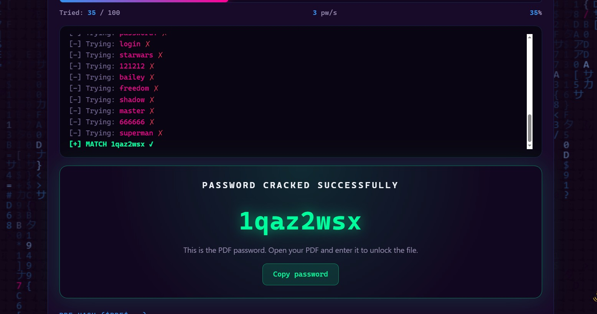

# networkwalk.B084B-WK3-PM1-PM2-PASSWORD-CRACKING
Password Cracking with JTR and NetworkWalks Tools
## About This Project
This project documents two practical exercises completed during Week 3 of my Cybersecurity internship at NetworkWalks.

The first exercise focused on cracking the password of a protected PDF file, My Locked PDF1.pdf, using John the Ripper (JTR) through the Kali Linux command line.

The second exercise focused on My Locked PDF2.pdf using the NetworkWalks Hash Calculator and NetworkWalks Password Cracker web tools.

The exercises provided practical experience with password hashes, wordlist-based password cracking, and the importance of using strong passwords to protect sensitive files.

## 🛡️ Liability Disclaimer
I carried out these activities only on files provided for cybersecurity training purposes as part of my NetworkWalks internship. These exercises are intended for educational purposes only. Password-cracking techniques should only be used on files, systems, or accounts that you own or have explicit permission to test.

## 🛠️ Tools Used

| Tool | Purpose |
|---|---|
| Kali Linux | Operating system used to run John the Ripper for password cracking |
| John the Ripper (john) | Cracks the extracted PDF hash using its built-in wordlist |
| pdf2john | Extracts a crackable hash from the password-protected PDF |
| Networkwalks Hash Calculator | Web tool used to extract the PDF hash without any installation |
| Networkwalks Password Cracker | Web tool used to run a dictionary attack against the extracted hash |

## 🎯 Activities Performed
# 4.1 Password Cracking with JTR (W3-PM1)
Target

File: My Locked PDF1.pdf

I used John the Ripper in Kali Linux to crack the password of the protected PDF. The exercise involved extracting the PDF hash and passing it to John the Ripper for password recovery.

Step 1 — Extract the hash

I used pdf2john to extract the password hash from the protected PDF and saved the output for use with John the Ripper.

pdf2john "My Locked PDF1.pdf" > pdf_hash.txt

Step 2 — Run John the Ripper

The extracted hash was passed to John the Ripper for password cracking.

john pdf_hash.txt

Step 3 — Display the Recovered Password

I used the --show option to display the recovered password.

john --show pdf_hash.txt

The result showed that 1 password hash was cracked and 0 remained.

Recovered password: good-luck

Step 4 — Verify the Password

The recovered password was entered into My Locked PDF1.pdf to confirm that it successfully unlocked the file.

## Results

## 🔍 Risk Analysis and Impact

| Finding | Evidence | Potential Impact |
|---|---|---|
| Weak password protection | The password good-luck was recovered from the first protected PDF using JTR | Weak passwords can be vulnerable to password-cracking techniques |
| Predictable password | The password password1 was recovered from the second protected PDF | Common or predictable passwords can make protected files easier to access |
| Password hashes can be tested offline | The PDF hashes were extracted and used for password recovery | If an attacker obtains a password hash, they may attempt offline cracking |

These findings are based on controlled cybersecurity training exercises and do not represent an assessment of a real-world system.

## 💡 Recommendations
Use long and unique passwords for protecting sensitive files.
Avoid common words, phrases, and predictable password patterns.
Use strong passphrases or randomly generated passwords.
Avoid reusing passwords across different files and accounts.
Consider using a password manager to generate and store strong passwords.
Use additional security controls where available, such as encryption and multi-factor authentication.
Only perform password-cracking activities on files or systems where proper authorization has been given
## 🎓 Conclusion
During Week 3 of my Cybersecurity internship at NetworkWalks, I completed two practical password-cracking exercises.

In W3-PM1, I used pdf2john and John the Ripper in Kali Linux to extract and crack the password hash of My Locked PDF1.pdf. The recovered password was good-luck, and I verified that it successfully unlocked the PDF.

In W3-PM2, I used the NetworkWalks Hash Calculator and NetworkWalks Password Cracker with My Locked PDF2.pdf. The recovered password was password1, which was also successfully verified.

These exercises helped me understand the practical process of extracting password hashes, using password-cracking tools, and the importance of strong passwords when protecting sensitive files.

## 👤 Author
EFOSA OSAWARU--- Cybersecurity Intern B084B

